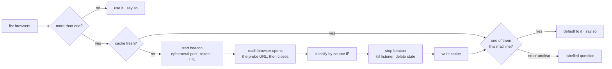

# chrome-pick

Know which Chrome is which before Claude touches it.


Claude sees your connected browsers like this:

```json
[{"deviceId":"e324d16a-...","name":"Browser 1","osPlatform":"macOS","isLocal":true},
 {"deviceId":"2175f1c8-...","name":"Browser 2","osPlatform":"macOS","isLocal":true}]
```

Names are ordinals. Both `isLocal: true`. If Chrome is open on your desktop *and* a work
laptop, "open this page" is a coin flip — and half the time it lands on the machine you
are screen-sharing.

chrome-pick makes every connected browser fetch one URL from a temporary local server, then
names each one by the source IP the request arrived from — so `Browser 2` becomes
`work laptop · 10.0.0.57 · Windows` before anything gets driven.

## What it plugs into

Claude Code ships a built-in **claude-in-chrome** skill, loaded automatically before any
`mcp__claude-in-chrome__*` tool runs. That skill is what actually drives the browser —
clicking elements, filling forms, capturing screenshots, reading console logs and
navigating — in new tabs inside your existing Chrome session, gated by the site-level
permissions you set in the extension.

It also carries one hard rule, quoted from the skill itself:

> Before any browser action, you MUST call [`list_connected_browsers`] … with a question
> listing EVERY connected browser as a separate option (use the display name as the label,
> and include the deviceId in parentheses) … **Do not skip any connected browser and do not
> pick one yourself.**

The rule is right: nothing should silently choose which machine gets driven. Read it as
scoped to what it is protecting against — driving the *wrong machine* — which takes two
candidates to be possible at all. The problem is what it has to work with. The display
names it is told to use as labels are ordinals, so on the runs where the question genuinely
matters it ends up asking one you have no way to answer:

| | Built-in skill alone | With chrome-pick |
|---|---|---|
| **Option 1** | `Browser 1` | `Browser 1 — this Mac (e324d16a)` **[Recommended]** |
| **Option 2** | `Browser 2` | `Browser 2 — work laptop (2175f1c8)` |
| **Evidence** | none | `source 10.0.0.57 · work-mbp.lan · Windows · high confidence` |
| **Cost** | — | nothing on a cached run |

chrome-pick does not replace that skill, remove its question, or answer it for you. It runs
first and fills in the labels, then hands the informed choice back — on the runs where
there is a choice to hand back. It also marks the browser that matches your target as
recommended — a home-LAN address gets `this-mac` — so the common case is one keystroke
rather than a guess.

## When it asks

A question with one possible answer is not a safety mechanism, it is friction. So the
prompt is reserved for real ambiguity. After `list_connected_browsers`:

| What is connected | What happens |
|---|---|
| **One browser** | Uses it. No question — the one option and the "select the right one there" fallback are the same browser. |
| **Several, exactly one of them this machine** | Defaults to that one. No question. |
| **Several, and this machine is none of them or more than one** | **Asks** — every browser listed, plus the exact final option, nothing picked for you. |
| **Several, and the probe can't tell** | **Asks**, the same way. Not knowing is the case the rule exists for. |

Whether a browser is this machine comes from `isLocal` first, then the cache, then a probe
— and a lone browser already reporting `isLocal: true` is not probed at all.

Neither of the first two rows is skipping the rule: its precondition — more than one
machine you could plausibly be driving — is not met. And nothing goes silent. The
assumption is stated in one clause as it acts, "using the only connected Chrome (this
Mac)" or "defaulting to the Chrome on this Mac", so a wrong browser stays visible and
correctable without a blocking prompt in front of every task.

You override it whenever you like. "wrong browser", "which chrome", "pick the browser",
"that's my work laptop" or naming a machine gets you the question — or that machine
directly. "re-probe" forces fresh labels.

## Install

```sh
git clone https://github.com/jhammant/chrome-pick-skill.git
ln -s "$PWD/chrome-pick-skill/skill" ~/.claude/skills/chrome-pick
```

Needs macOS, [Claude Code](https://claude.com/claude-code) with the Chrome extension
connected, and `/usr/bin/python3`. No pip, no npm — stdlib only, pinned to the system
interpreter so a venv or asdf shim can't interfere.

Claude loads it next session. It fires at the start of any browser task, and on "wrong
browser", "which chrome", "that's my work laptop", or "re-probe".

## Labels

| Source IP | Label | Meaning |
|---|---|---|
| `127.0.0.1` or this Mac's own address | `this-mac` | The Chrome in front of you |
| Other RFC1918 | `same-lan` | Another machine on your network |
| `100.64.0.0/10` | `tailnet` | Reached you over Tailscale |
| Public | `remote` | Via NAT, a relay or a port forward |
| Nothing arrived | `unreachable` | Different network, or a VPN on that machine |

Labels are cached in `~/.claude/chrome-browsers.json`, so the usual run costs nothing —
no probe, just a label to act on, or a labelled question when it is genuinely ambiguous.
It re-probes only when a label could be wrong: an unknown browser appears, or this Mac
moved to another LAN where `10.0.0.57` no longer means what it did yesterday. A browser
going offline invalidates nothing.

## How it works



Four rules it will not break:

- **Never silently picks the machine.** Where two or more could be the one you mean, it
  asks — every browser listed, nothing chosen for you; better labels make that question
  better, not optional. Where only one can be, it uses it and says so as it acts.
- **Never invents a label.** A failed probe downgrades to `unreachable` and gets out of
  the way. It does not block the task.
- **Leaves nothing behind.** Beacon dies on its TTL, `stop` kills the listener and deletes
  its state, every tab it opens it closes. Pre-existing tabs are never touched.
- **A `selftest` pass is not proof of reachability.** Traffic from this Mac to its own LAN
  IP short-circuits internally and never crosses the wire. The tool says so itself rather
  than letting you conclude otherwise.

## If someone else sees the tab

A probed browser on another desk shows one page for a moment:

> **chrome-pick — this browser has been identified.** Claude Code opened this tab only to
> work out which machine this Chrome is running on, by looking at the network address the
> request came from. Nothing was read from this browser and nothing was sent anywhere.

The probe URL carries a deviceId and a random nonce. Nothing else. Wrong token gets a 403
and records no hit.

## Limits

- **macOS only** — shells out to `ifconfig`, `route`, `arp`.
- **Separates machines, not profiles.** Two Chromes on one Mac both answer from the same
  address and both read `this-mac`.
- **A firewall or full-tunnel VPN can make a real browser look `unreachable`.** Reported as
  a caveat, never a conclusion. [`reference/troubleshooting.md`](skill/reference/troubleshooting.md)
  covers thirteen failure modes seen in practice — ProtonVPN's kill switch, macOS stealth
  mode, `navigate` silently upgrading `http://` to HTTPS.

## Tests

```sh
/usr/bin/python3 -m unittest discover -s test -v
```

Twelve end-to-end tests against the real scripts, under a temporary `HOME` so your own
cache is untouched. Full lifecycle (start → probe → classify → stop → port closed), 403 on
a bad token, cache invalidation rules, and a human-set label surviving every re-probe.

A genuinely remote browser can't be tested here — that needs a second machine.

## License

MIT

## Codex

Codex has a separate Chrome runtime. Install its small adapter instead of the
Claude extension's device-ID/beacon workflow:

```bash
mkdir -p "$HOME/.agents/skills"
ln -s "$PWD/skill-codex" "$HOME/.agents/skills/chrome-pick"
```

Run this from the repository root, then start a new Codex conversation. Inspect
an existing destination before replacing it. The adapter requires Codex's
Chrome plugin and follows its supported browser selection/troubleshooting.
It does not port the Claude extension's multi-machine beacon functionality.
